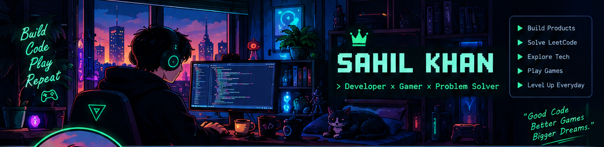

<div align="center">



### `PLAYER 01` · DEVELOPER · BUILDER · PROBLEM SOLVER

**Building cool products, writing code, solving problems, and leveling up every day.** 🚀

[](https://github.com/Sksahilkhan67sh)
[](https://www.linkedin.com/)
[](https://leetcode.com/)

</div>

---

## 🎮 Player Profile

```yaml
name: Sahil Khan
class: Full-Stack Developer
education: B.Tech CSE | 2022–2026
current_mission: Build reliable, production-ready software & Powerfull SAAS
quests:
  - Full-stack development
  - AI-powered applications
  - Scalable SaaS architecture
  - Data Structures & Algorithms
motto: Learn → Build → Ship → Improve
```

## ⚔️ Tech Inventory

<div align="center">

**Languages**


**Frameworks & Runtime**


**Databases, Cloud & Tools**


</div>

## 🧩 Featured Missions

<table>
<tr>
<td width="50%" valign="top">

### 🎬 STREAM-VAULT
A live-streaming SaaS concept with creator tools, viewer experiences, and monetization features.

`Next.js` `Express` `PostgreSQL` `LiveKit`

</td>
<td width="50%" valign="top">

### 📞 AI Calling Agent
An AI calling platform concept for automated calls, conversation records, feedback, and analytics.

`FastAPI` `React` `PostgreSQL` `Docker`

</td>
</tr>
<tr>
<td width="50%" valign="top">

### 🔌 RelayHub
A webhook delivery service focused on signed requests, retries, and dead-letter handling.

`Node.js` `Express` `SQLite`

</td>
<td width="50%" valign="top">

### 🕹️ SquadLink
A social and gaming community platform for developers and gamers.

`React` `NestJS` `Prisma` `PostgreSQL` `Redis`

</td>
</tr>
</table>

## 📊 GitHub Character Stats

<div align="center">

<a href="https://github.com/Sksahilkhan67sh">
  
</a>
<a href="https://github.com/Sksahilkhan67sh">
  
</a>

<br/>


</div>

## 🐍 Contribution Snake — Eat the XP!

<div align="center">

<!-- Snake animation is generated by GitHub Actions; it may take one workflow run to appear. -->


**Every contribution adds another block to the world.** 🎮

</div>

## 🏆 Achievement Hall

- 🧱 **World Builder** — Turn ideas into working applications.
- ⚙️ **System Crafter** — Explore APIs, databases, and backend architecture.
- 🔥 **Consistency Quest** — Keep learning and solving problems.
- 🚀 **Ship It** — Improve projects through testing, feedback, and iteration.

> These are personal quest titles, not official GitHub badges.

---

<div align="center">

### `GG WP` — THE JOURNEY CONTINUES.

**One commit at a time. One level at a time.**


</div>
